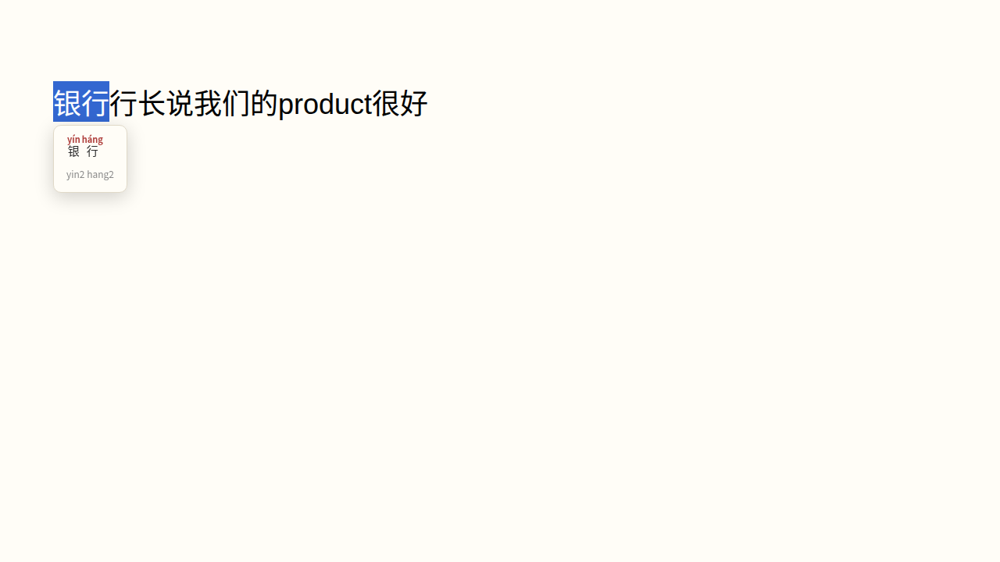
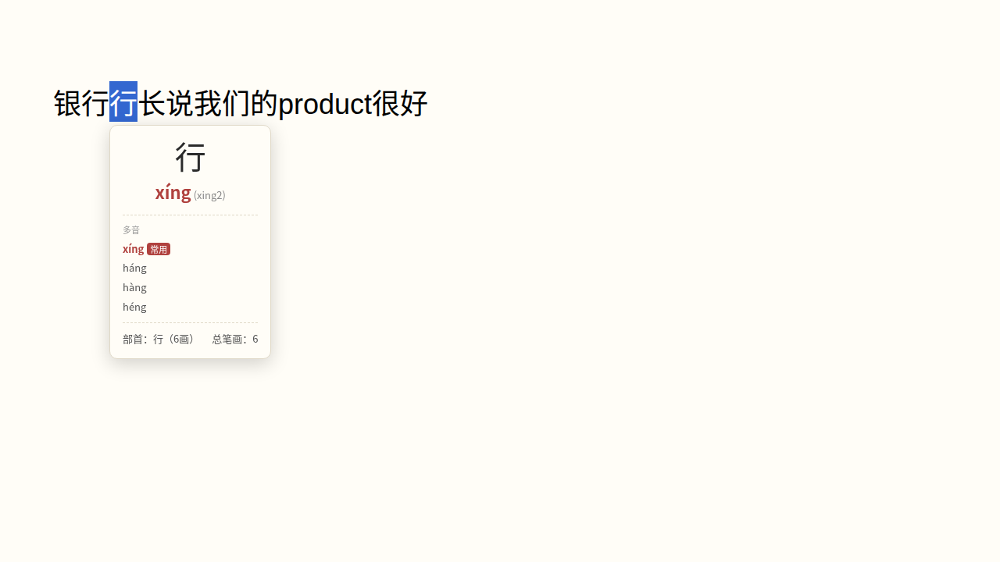

<div align="center">

# 拼音弹窗 Pinyin Popup

**选中网页上的中文，弹出拼音。**

划词即注音 · 离线词典 · 词级消歧 · 零权限


</div>

## 效果

选中词组 —— 多音字按词形给出正确读音：



选中单字 —— 列出全部读音、标注常用音，附部首笔画：



## 功能

- ✏️ **划词注音**：鼠标拖选中文即弹出拼音卡片，点击别处或 `Esc` 关闭
- 🎯 **词级消歧**：多音字按完整词形定音——「银行」的「行」是 háng，不是 xíng
- 🔤 **双格式拼音**：调号为主，附数字调（`háng (hang2)`）
- 📖 **单字卡片**：多音列表标注常用音，附部首、笔画数
- 🀄 **简繁通吃**：简体繁体字均支持
- 🈶 **中英混排**：中文字注音，其他字符原样透传
- ⚡ **纯离线**：词典打包在插件内，不联网、不上传任何内容

## 安装

### 从源码构建

```bash
npm install
npm run build
```

### 加载到浏览器

1. 打开 `chrome://extensions`（Edge 为 `edge://extensions`）
2. 右上角开启 **开发者模式**
3. 点击 **加载已解压的扩展程序**，选择项目下的 `dist/` 目录
4. 打开任意网页，选中中文试试

## 说明

- 选区超过 30 字会截断注音（保持弹窗小巧）
- 仅响应鼠标拖选，键盘选择（如 `Ctrl+A`）不触发
- 无 `storage` / `tabs` 等权限，只有页面展示所需的最小权限

## 项目结构

```
├── manifest.json      # MV3 清单
├── src/content.js     # 内容脚本：选区监听 + Shadow DOM 弹窗
├── GLOSSARY.md        # 领域词汇表
├── docs/adr/          # 架构决策记录
└── assets/            # 文档图片
```

词典来自 [pinyin-pro](https://www.npmjs.com/package/pinyin-pro)（拼音、消歧）与 [cnchar](https://www.npmjs.com/package/cnchar)（部首、笔画），经 [CRXJS](https://crxjs.dev) 打包。

## License

MIT
